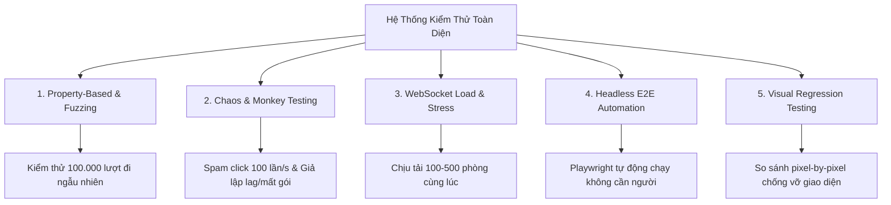

# 📋 KẾ HOẠCH NÂNG CẤP HỆ THỐNG KIỂM THỬ TOÀN DIỆN
### *Dự án: Cờ Tỷ Phú Sài Gòn — Saigon Tycoon (Multiplayer Web Game)*

---

## 📌 I. Tổng Quan & Mục Tiêu

### 1. Hiện Trạng Hệ Thống Kiểm Thử (Baseline)
Hiện tại, dự án đã có nền tảng kiểm thử khá vững chắc với **7 bộ test tự động** chạy qua Node.js (`npm run test:all`) cùng bộ công cụ In-Game Dev Tools (`⚡ Test Luật`):
* ✅ Quét 24 file ES Module Client chống lỗi cú pháp / circular dependency (`test-client-imports.mjs`).
* ✅ Kiểm tra tính tất định của thuật toán xúc xắc `Mulberry32 PRNG` qua 30 lượt mô phỏng (`test-deterministic.mjs`).
* ✅ Kiểm thử bắt tay mạng WebSocket Server (2 Clients) và xác thực tung xúc xắc (`test-server.mjs`).
* ✅ Kiểm tra 6 nhóm luật thi đấu đặc biệt: x2 rent, xây đều tay, đấu giá, thế chấp (`test-audit-fixes.mjs`).
* ✅ Giả lập kịch bản ván cờ mạng 7 bước kèm ngắt và tái kết nối (`reconnectToken`) (`test-online-simulation.mjs`).
* ✅ Chống lỗi nhảy lượt bằng khóa an toàn mã phiên (`stale turnId rejection`) (`test-turn-skip-fix.mjs`).
* ✅ Kiểm thử chính xác 32 hiệu ứng thẻ Cơ Hội & Khí Vận và phí sửa chữa nhà (`test-card-effects.mjs`).

### 2. Mục Tiêu Nâng Cấp
Nâng tầm dự án từ mức **"chạy tốt các kịch bản chuẩn" (Happy Path)** lên mức **"sẵn sàng chịu tải và chống lỗi cấp độ Production" (Fault-Tolerant & Production-Ready)** bằng **5 phương pháp kiểm thử nâng cao**.

---

## 🚀 II. Chi Tiết 5 Phương Pháp Kiểm Thử Nâng Cao

---

### GIAI ĐOẠN 1: Property-Based & Fuzz Testing (Kiểm thử Bất Biến & Dữ Liệu Ngẫu Nhiên)

> **Mục tiêu:** Phát hiện các lỗi logic cực hiếm mà con người không thể tự nghĩ ra bằng cách cho máy tự động sinh hàng trăm ngàn lượt đi ngẫu nhiên.

#### 1. Các "Đặc tính bất biến" (Invariants) cần kiểm tra:
* **Bảo toàn tiền tệ:** Không có bất kỳ giao dịch nào sinh ra giá trị `NaN`, `undefined`, `null` hoặc số tiền bị chuỗi string hóa `"1000000200000"`.
* **Ràng buộc số lượng công trình:** 
  * Số nhà trên 1 ô đất luôn nằm trong khoảng `[0, 4]`.
  * Số khách sạn chỉ có thể là `0` hoặc `1`.
  * Tổng số nhà trên bàn cờ không bao giờ vượt quá giới hạn 32 nhà và 12 khách sạn của Ngân hàng.
* **Toàn vẹn quyền sở hữu đất:** Một ô đất tại một thời điểm chỉ thuộc về đúng 1 người chơi hoặc thuộc Ngân hàng.

#### 2. Kịch bản triển khai:
* Viết file `tests/test-fuzzing-engine.mjs`.
* Chạy vòng lặp giả lập **10.000 ván cờ** giữa 4 Bot với hạt giống ngẫu nhiên.
* Mỗi lượt cho Bot thực hiện hành vi ngẫu nhiên: mua, từ chối mua, thế chấp, chuộc đất, xây nhà, phá sản.
* Sau mỗi lượt đi, chạy hàm xác thực `validateStateIntegrity(state)`. Nếu có bất kỳ bất thường nào $\rightarrow$ ghi log hạt giống `seed` để tái hiện lỗi ngay lập tức.

---

### GIAI ĐOẠN 2: Chaos & Monkey Testing (Kiểm thử Hỗn Loạn & Phá Hoại)

> **Mục tiêu:** Đo lường độ bền của Game Client và Server trước các hành vi bấm loạn xạ của người dùng và điều kiện mạng cực kỳ xấu.

#### 1. Chaos Network (Mạng bất ổn định):
* **Độ trễ cao (High Latency):** Cố tình trì hoãn phản hồi WebSocket từ 500ms đến 2.000ms.
* **Mất gói tin (Packet Dropping):** Giả lập tỷ lệ rớt 20% gói tin mạng.
* **Ngắt kết nối lặp đi lặp lại (Flapping Connection):** Cứ mỗi 10 giây tự ngắt socket và kết nối lại liên tục 5 lần giữa lúc đang đổ xúc xắc hoặc đang trong phiên đấu giá.
* **Tiêu chí đạt:** Client không bao giờ bị treo màn hình xám; hiển thị banner thông báo mất kết nối và tự động phục hồi ngay khi mạng ổn định lại.

#### 2. UI Monkey Testing (Bấm loạn xạ):
* Tự động sinh sự kiện click liên tục vào mọi phần tử tương tác:
  * Click nút *Tung xúc xắc* 50 lần trong 1 giây.
  * Mở/Đóng liên tục các modal (Đấu giá, Sổ tay, Thành tựu, Đài radio).
  * Vừa kéo thanh tần số radio vừa chuyển tab điều hướng mobile.
* **Tiêu chí đạt:** Trình duyệt không bị rò rỉ bộ nhớ (Memory Leak), không có Uncaught Promise Rejection trong Console.

---

### GIAI ĐOẠN 3: WebSocket Load & Stress Testing (Kiểm thử Chịu Tải Server)

> **Mục tiêu:** Khám phá giới hạn chịu tải tối đa của WebSocket Server Node.js (viết bằng thư viện `ws`).

#### 1. Thông số kịch bản:
* Viết file script `tests/stress-test-server.mjs`.
* Sinh đồng thời từ **50 đến 250 phòng cờ ảo** (tương đương **200 – 1.000 kết nối socket đồng thời**).
* Mỗi phòng tự động chạy chu kỳ: Tạo phòng $\rightarrow$ Người chơi vào phòng $\rightarrow$ Tung xúc xắc $\rightarrow$ Chuyển lượt với tần suất 1 action/giây.

#### 2. Các chỉ số theo dõi (Metrics):
| Chỉ số | Ngưỡng mong muốn | Ngưỡng cảnh báo |
|---|---|---|
| **CPU Server** | < 40% | > 80% |
| **RAM Server** | < 120 MB | > 350 MB |
| **Độ trễ Broadcast (Ping)** | < 15ms | > 100ms |
| **Tỷ lệ rớt kết nối** | 0% | > 1% |

---

### GIAI ĐOẠN 4: Automated Headless E2E Testing với Playwright

> **Mục tiêu:** Tự động hóa 100% việc kiểm thử giao diện người dùng thực tế mà không cần mở trình duyệt bằng tay.

#### 1. Luồng kiểm thử tự động (End-to-End User Journeys):
1. Khởi động 2 tab trình duyệt ẩn danh không đầu (Headless Chromium).
2. Tab 1 tạo phòng $\rightarrow$ Tab 2 đọc mã phòng từ DOM và join vào phòng.
3. Tab 1 bấm Tung xúc xắc $\rightarrow$ Kiểm tra hiệu ứng xúc xắc 3D lăn và quân cờ di chuyển đúng số ô trên màn hình của Tab 2.
4. Kiểm tra âm thanh Web Audio API khởi tạo thành công khi người dùng tương tác lần đầu.
5. Kiểm tra tải ảnh poster tổng kết ván đấu (Match Recap Canvas) thành công với định dạng PNG hợp lệ.

---

### GIAI ĐOẠN 5: Visual Regression Testing (Kiểm thử Hồi Quy Bằng Hình Ảnh)

> **Mục tiêu:** Ngăn chặn triệt để tình trạng sửa CSS ở trang này làm vỡ bố cục hoặc tràn chữ ở trang khác.

#### 1. Kịch bản kiểm tra:
* Sử dụng thư viện so khớp ảnh nhẹ (ví dụ `pixelmatch` hoặc tính năng chụp so sánh của Playwright).
* Chụp ảnh chuẩn (Gold Master Screenshots) ở 4 độ phân giải tiêu chuẩn:
  * **Desktop 2K:** 1920×1080.
  * **Laptop phổ biến:** 1366×768 và 1280×720.
  * **Tablet:** 820×1180.
  * **Mobile:** 375×812 (iPhone X/13/14) và 360×800 (Android phổ thông).
* So sánh từng pixel: Nếu diện tích sai lệch (mismatched pixels) vượt quá **0.05%** $\rightarrow$ Tạo file ảnh diff đỏ cảnh báo vị trí bị tràn hoặc vỡ layout.

---

## 📅 III. Lộ Trình Triển Khai (Roadmap & Ưu Tiên)

| Thứ tự | Phương pháp | Thời gian ước tính | Mức độ ưu tiên | Độ phức tạp |
|:---:|---|:---:|:---:|:---:|
| **P1** | **Property-Based & Fuzzing Engine** | 1 – 2 ngày | 🔥 Cực cao | Trung bình |
| **P2** | **Chaos & Reconnection Stress** | 1 ngày | 🔥 Cực cao | Thấp |
| **P3** | **WebSocket Server Load Test** | 1 ngày | ⚡ Cao | Trung bình |
| **P4** | **Playwright Headless E2E Test** | 2 – 3 ngày | ⚡ Cao | Cao |
| **P5** | **Visual Regression Testing** | 2 ngày | 💡 Trung bình | Trung bình |

---

## 🎯 IV. Giá Trị Thực Chiến Khi Phỏng Vấn (Interview Selling Points)

Khi Nhà tuyển dụng hoặc Tech Lead hỏi: *"Em đã kiểm thử dự án này như thế nào?"*, bạn có thể tự tin trình bày theo cấu trúc chuẩn:

1. **Từ cơ bản:** Em xây dựng bộ test native bằng ES Modules không phụ thuộc thư viện nặng, chạy 7 bộ test kiểm thử từ Unit Test logic PRNG đến Integration Test WebSocket.
2. **Đến chuyên sâu:** Em áp dụng **Property-Based Fuzzing** chạy 10.000 ván cờ ngẫu nhiên để chứng minh luật tài chính luôn bảo toàn.
3. **Về độ tin cậy thời gian thực:** Em giả lập **Chaos Network** (ngắt kết nối ngẫu nhiên và trễ mạng 2s) để chứng minh cơ chế **Grace Period 45s** và `turnId rejection` bảo vệ ván cờ không bao giờ bị desync hay mất dữ liệu.
