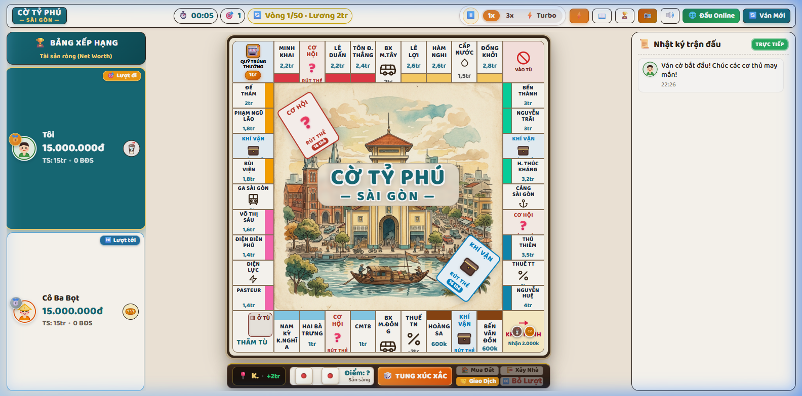
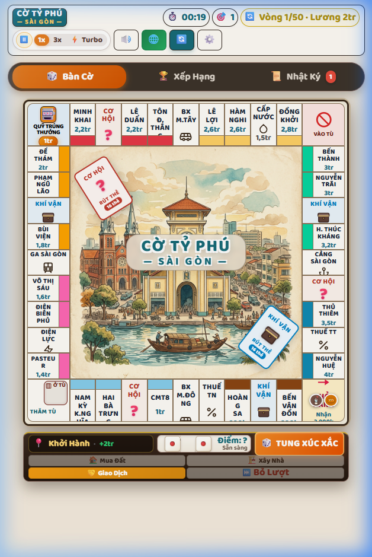
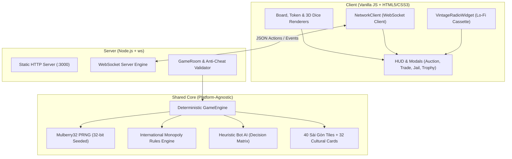

# 🎲 CỜ TỶ PHÚ SÀI GÒN — SAIGON TYCOON
### *Bàn cờ kinh doanh bất động sản đậm chất văn hóa Hòn Ngọc Viễn Đông*

[](https://nodejs.org/)
[](https://github.com/websockets/ws)
[](https://developer.mozilla.org/)
[-brightgreen?logo=checkmarx&logoColor=white)](tests/)
[](LICENSE)

> Dự án game Cờ Tỷ Phú hoàn chỉnh chuẩn 100% luật thi đấu quốc tế, xây dựng hoàn toàn bằng **Vanilla JavaScript (ES Modules)**, **HTML5/CSS3** và **Node.js WebSocket Server**. Không phụ thuộc vào bất kỳ UI framework cồng kềnh nào (Zero-Dependency UI).

---

## 📸 Trải Nghiệm Giao Diện Thực Tế (Visual Showcase)

| 🖥️ Giao diện Desktop (Bố cục 3 Cột) | 📱 Giao diện Mobile (3 Tab & Menu ⚙️) |
|:---:|:---:|
|  |  |
| *Bảng xếp hạng tài sản, Bàn cờ trung tâm, Dòng thời gian trực tiếp* | *Điều hướng 3 Tab: Bàn cờ, Xếp hạng, Nhật ký; Menu ⚙️ tinh gọn* |

---

## 🌟 Điểm Nhấn Kiến Trúc & Kỹ Thuật (Engineering Highlights)

> 💡 *Dành cho Nhà tuyển dụng / Tech Lead quan tâm đến chất lượng code và thiết kế hệ thống:*



1. **Deterministic State Machine (Máy trạng thái tất định):**
   * Sử dụng thuật toán sinh số giả ngẫu nhiên có hạt giống **Mulberry32 PRNG (32-bit)**. 
   * Cùng một `seed` và chuỗi hành động sẽ cho ra kết quả đồng nhất 100% trên cả Server lẫn Client, loại bỏ hoàn toàn hiện tượng lệch trạng thái (Desync).

2. **Chế độ Chơi Đa Người (Realtime WebSocket Multiplayer):**
   * Tự xây dựng giao thức WebSocket trên nền thư viện nhẹ `ws` của Node.js.
   * **Cơ chế chống gian lận (Server-Authoritative Anti-Cheat):** Client không thể gửi kết quả xúc xắc hoặc tự ý chọn ô đáp đất; Server tự tính toán và phân giải nước đi hợp lệ.
   * **Bảo vệ rớt mạng (45s Grace Period Reconnection):** Khi người chơi bị ngắt kết nối (F5 trang, mạng 4G chập chờn), phòng đấu không bị hủy ngay mà chờ 45 giây. Người chơi vào lại sẽ tự động khôi phục vị trí, tiền bạc và tài sản nguyên vẹn bằng `reconnectToken`.
   * **Cơ chế chống nhảy lượt (Stale Turn Rejection):** Quản lý phiên bằng `turnId` tăng dần; mọi gói tin gửi trễ từ lượt trước đều bị từ chối an toàn.

3. **Hệ Thống Responsive Đa Cấp & Trải Nghiệm Mobile Tối Ưu:**
   * Áp dụng cơ chế **Co giãn lũy tiến (Progressive Responsive)** thích ứng hoàn hảo trên 3 cấp độ:
     * **Màn hình lớn (> 1440px):** Đầy đủ biểu tượng, minh họa Chợ Bến Thành và nhãn nút.
     * **Laptop / Tablet ngang (901px – 1440px):** Tự động chuyển đổi các nút phụ thành icon vuông vắn, ẩn nhãn text thừa, đảm bảo không bao giờ bị tràn thanh Header.
     * **Mobile / Tablet dọc (≤ 900px):** Hệ thống chuyển tab 3 chế độ (`🎲 Bàn Cờ`, `🏆 Xếp Hạng`, `📜 Nhật Ký`) và menu popover tiện ích `⚙️`, toàn bộ công cụ cốt lõi nằm gọn gàng trên 1 hàng 28px.

4. **Zero-Dependency Frontend & Âm Thanh Hoài Cổ:**
   * Không dùng framework cồng kềnh, 100% Native DOM API, Grid 11x11 diorama và hiệu ứng 3D chuyển động mượt mà ở 60fps.
   * Âm thanh được tổng hợp chân thực bằng **Web Audio API** (không cần file mp3 nặng nề) kết hợp đài cassette Lo-Fi phát nhạc Sài Gòn xưa.

5. **Trí Tuệ Nhân Tạo (Heuristic Bot AI):**
   * Bot tự động tính toán giá trị chiến lược của các ô đất, ưu tiên gom bộ màu độc quyền (Monopoly) và từ chối các giao dịch có lợi cho đối thủ.
   * Tích hợp tính cách và tâm trạng ngẫu nhiên (`Bot Mood`) cho từng nhân vật (Anh Ba Sài Gòn, Chị Bảy Bến Thành, Bác Xích Lô...).

---

## 🏛️ Tính Năng Trò Chơi (Game Features)

### 1. Luật Chơi Monopoly Chuẩn Quốc Tế
* **28 Bất động sản:** Gồm 22 ô phố Sài Gòn thuộc 8 nhóm màu, 4 Bến Xe (Bến Xe Miền Đông, Bến Xe Miền Tây, Ga Sài Gòn, Bến Xe Chợ Lớn) và 2 Nhà máy (Cấp Điện & Cấp Nước).
* **Nhân đôi tiền thuê đất (x2 Monopoly Rent):** Tự động nhân đôi tiền thuê đất trống khi gom đủ bộ màu.
* **Quy tắc xây dựng đều tay (Even-Building):** Phải nâng cấp nhà đều các ô trong cùng bộ (4 Nhà Phố Xanh ➔ 1 Khách Sạn Đỏ).
* **Đấu giá công khai (Auction):** Khi người chơi từ chối mua ô đất vừa dừng chân, ngân hàng mở phiên đấu giá cho toàn bộ người chơi còn lại.
* **Thế chấp & Chuộc sổ đỏ (Mortgage):** Vay ngân hàng 50% giá trị đất khi thiếu thanh khoản và chuộc lại với 10% phí lãi.
* **Thương lượng & Giao dịch tự do (Trade):** Mở bàn đàm phán trao đổi bất động sản kèm tiền mặt giữa các người chơi.
* **Giải quyết nợ nần & Phá sản (Debt Resolution):** Khi thiếu tiền trả nợ, mở bảng bán nhà, thế chấp đất khẩn cấp trước khi tuyên bố phá sản.
* **Cơ chế Tù giam quốc tế:** Vào tù khi lắc đôi 3 lần liên tiếp, dẫm ô Vào Tù (#30) hoặc rút trúng thẻ. Ra tù bằng thẻ, nộp phạt 500k hoặc lắc đôi trong 3 lượt.

### 2. Bản Sắc Văn Hóa Sài Gòn Hoài Cổ
* **32 Thẻ Cơ Hội & Khí Vận Thuần Việt:** *Lì xì Tết, Viện phí Chợ Rẫy, Thưởng vé số chiều, Kẹt xe Cầu Sài Gòn, Thưởng thức Cà phê Sữa Đá Bưu Điện...*
* **Bộ Quân Cờ Đặc Trưng:** *Ly Cà Phê Phin, Nón Lá, Xe Vespa Cổ, Xe Xích Lô, Ổ Bánh Mì Sài Gòn, Tô Hủ Tiếu Gõ, Thuyền Bến Bình Đông.*
* **Đài Radio Cát-xét Sài Gòn:** Tích hợp máy hát radio cổ điển phát sóng FM nhạc nền thư giãn Lo-Fi hoài niệm.

### 3. Bộ Điều Tốc Ván Đấu & Tiện Ích Hiện Đại
* **Điều tốc thời gian thực (Speed Controller):** Hỗ trợ `1x`, `3x`, `⚡ Turbo 10x` và `⏸️ Tạm dừng` giúp tua nhanh lượt bot thông minh hoặc kiểm tra diễn biến ván cờ thần tốc.
* **Tự động lưu ván đấu (Auto-Save & Resume):** Tự động lưu tiến trình vào `LocalStorage`, cho phép tiếp tục ván cờ sau khi vô tình đóng trình duyệt.

### 4. Phòng Trưng Bày Cúp (Trophy Room) & Poster Kỷ Lục
* **Hệ thống 7 thành tựu vinh danh:** Lưu trữ kỷ lục vĩnh viễn trên trình duyệt (`LocalStorage`).
* **Xuất Poster Tổng Kết Ván Đấu (Match Recap):** Vẽ biểu đồ biến động tài sản trực tiếp bằng **HTML5 Canvas 2D** và cho phép tải ảnh poster chất lượng cao (PNG HD).

---

## 📁 Cấu Trúc Thư Mục (Project Structure)

```
Monopoly/
├── docs/                        # Tài liệu dự án & Ảnh chụp màn hình
│   └── screenshots/             # Ảnh minh họa giao diện Desktop & Mobile
│
├── client/                      # Giao diện & Trình biểu diễn người dùng
│   ├── index.html               # File HTML chính của game
│   ├── assets/                  # Tranh nghệ thuật Chợ Bến Thành & Nhà Thờ Đức Bà
│   ├── css/
│   │   ├── main.css             # Layout 3 cột, Header, Mobile Responsive & Speed Bar
│   │   ├── board.css            # Lưới Grid bàn cờ 11x11, 40 ô cờ, nhà 3D, responsive
│   │   └── ui.css               # Modal hệ thống (Đấu giá, Giao dịch, Cúp, Portfolio)
│   └── js/
│       ├── main.js              # Controller điều phối Engine, Network và UI
│       ├── audio/               # Web Audio API Synthesizer & Sound Effects
│       ├── network/             # NetworkClient giao tiếp WebSocket với Server
│       ├── render/              # Render Bàn cờ, Xúc xắc 3D, Avatar và Quân cờ
│       └── ui/                  # Các lớp quản lý cửa sổ tương tác (HUD, Modals)
│
├── server/                      # WebSocket & HTTP Server (Node.js)
│   ├── server.mjs               # Static File Server, WebSocket Dispatcher & Heartbeat
│   └── room.js                  # Quản lý Phòng chơi, Sảnh chờ, Anti-Cheat, Timer
│
├── shared/                      # Mã nguồn Core Logic dùng chung (Platform-Agnostic)
│   ├── engine.js                # State Machine & Bộ phân giải luật Monopoly
│   ├── rules.js                 # Kiểm tra điều kiện mua, xây, thế chấp, phá sản
│   ├── BotAI.js                 # Thuật toán trí tuệ nhân tạo điều khiển Bot
│   ├── constants.js             # Hằng số cấu hình, định dạng tiền tệ VND
│   └── data/                    # Dữ liệu 40 ô cờ Sài Gòn, 32 thẻ bài
│
├── tests/                       # Bộ kiểm thử tự động toàn diện (Test Suites)
│   ├── test-client-imports.mjs  # Quét an toàn toàn bộ 24 file ES Module Client
│   ├── test-deterministic.mjs   # Kiểm tra tính tất định Mulberry32 (30 lượt mô phỏng)
│   ├── test-server.mjs          # Test tích hợp WebSocket Server & kiểm soát lượt
│   ├── test-audit-fixes.mjs     # Test xác minh 6 nhóm luật đặc biệt
│   ├── test-online-simulation.mjs # Giả lập 7 bước ván cờ mạng (Join, Roll, Disconnect, Reconnect)
│   ├── test-turn-skip-fix.mjs   # Test khóa an toàn mã lượt (Stale turnId rejection)
│   └── test-card-effects.mjs    # Test thực thi 32 thẻ Cơ Hội & Khí Vận
│
├── package.json                 # Cấu hình dự án & Test Scripts
└── README.md                    # Tài liệu kỹ thuật
```

---

## 🚀 Hướng Dẫn Cài Đặt & Chạy Trực Tiếp

### 1. Yêu Cầu Môi Trường
* **Node.js** phiên bản 18.0 trở lên.
* Trình duyệt hiện đại hỗ trợ ES Modules (Chrome, Safari, Edge, Firefox).

### 2. Cài Đặt & Khởi Chạy
```bash
# 1. Clone repository về máy
git clone https://github.com/dinhanhhhh/Monopoly.git
cd Monopoly

# 2. Cài đặt dependencies (chỉ chứa gói 'ws' siêu nhẹ cho server)
npm install

# 3. Khởi chạy Server kết hợp Web Game
npm start
```

Sau khi chạy lệnh trên, mở trình duyệt truy cập:
* 🌐 **Web Game:** `http://localhost:3000`
* 🔌 **WebSocket Endpoint:** `ws://localhost:3000`
* 🩺 **Health Check:** `http://localhost:3000/health`

*(Hoặc dùng lệnh `npm run dev` để tự động khởi động lại server mỗi khi sửa code).*

### 3. Trải Nghiệm Chế Độ Chơi Online (Multiplayer LAN / Local)
1. Mở **2 cửa sổ trình duyệt** (ví dụ: 1 tab bình thường và 1 tab ẩn danh `Incognito`) cùng truy cập `http://localhost:3000`.
2. Nhấn nút **🌐 Đấu Online** trên thanh Header:
   * **Tab 1 (Chủ phòng):** Nhập tên người chơi và nhấn **"Tạo phòng mới"** ➔ Nhận mã phòng 4 ký tự (ví dụ: `SG88`).
   * **Tab 2 (Khách mời):** Nhập tên người chơi, điền mã phòng `SG88` và nhấn **"Vào phòng"**.
3. Chủ phòng có thể thêm Bot lấp đầy các vị trí còn trống và nhấn **"Bắt đầu ván đấu"** để thi đấu thời gian thực qua WebSocket.

---

## 🧪 Kiểm Thử Tự Động (Automated Testing)

Dự án được bảo vệ bởi **7 bộ kịch bản test** bao phủ toàn bộ logic từ Client, Deterministic Engine đến WebSocket Server:

```bash
# Chạy toàn bộ 7 bộ test tự động:
npm run test:all
```

**Danh sách test case được nghiệm thu 100%:**
* ✅ **Client Imports Safety (`test-client-imports.mjs`):** 24 file client nạp độc lập không bị vòng lặp phụ thuộc (circular dependency).
* ✅ **Deterministic PRNG (`test-deterministic.mjs`):** 2 Engine độc lập cùng seed sinh 30 nước đi ra kết quả trùng khớp từng đồng xu.
* ✅ **Server Integration (`test-server.mjs`):** Chặn thao tác trái lượt, xác thực kết quả tung xúc xắc phía server.
* ✅ **Special Rules Audit (`test-audit-fixes.mjs`):** Kiểm tra 6 nhóm luật thi đấu (nhân đôi tiền thuê, xây đều, đấu giá, thế chấp).
* ✅ **Multiplayer Simulation (`test-online-simulation.mjs`):** Giả lập ván đấu mạng 7 bước: Host, Guest, Bot; ngắt mạng và tái kết nối (`reconnectToken`) thành công.
* ✅ **Turn Safety & Anti-Desync (`test-turn-skip-fix.mjs`):** Chặn đứng lệnh `END_TURN` cũ, tránh hoàn toàn lỗi nhảy lượt.
* ✅ **Card Actions & Bank Fees (`test-card-effects.mjs`):** Kiểm thử tính chính xác các hiệu ứng rút thẻ Cơ Hội/Khí Vận và tính phí sửa chữa nhà/khách sạn.

---

## 🛠️ Công Nghệ Sử Dụng (Tech Stack)

| Lớp (Layer) | Công Nghệ | Ghi Chú Kỹ Thuật |
|---|---|---|
| **Frontend UI** | Vanilla HTML5, CSS3, ES Modules | Không dùng Framework, 100% Native DOM API, Grid 11x11 Diorama |
| **Backend & Realtime** | Node.js, `ws` (WebSocket) | Server-Authoritative Engine, Reconnect Grace Period 45s |
| **Graphics & Audio** | Canvas 2D, Web Audio API | Vẽ biểu đồ tài sản và tổng hợp âm thanh không phụ thuộc file ngoài |
| **State & Storage** | LocalStorage API, Seeded PRNG | Lưu trữ vĩnh viễn ván chơi và thành tựu cá nhân |
| **Testing** | Node.js Test Runners | 7 test suites, không cần Jest/Mocha nặng nề, assert native nhanh gọn |

---

## 📜 Giấy Phép (License)

Dự án được phát hành theo giấy phép **MIT License**. Bạn được tự do tham khảo, học tập và phát triển thêm.

---
*Kiến tạo tài sản — Thịnh vượng tương lai cùng Cờ Tỷ Phú Sài Gòn!* 🏙️🎩🎲
