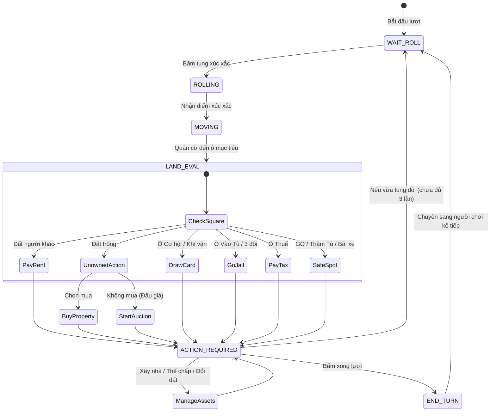

# 🎲 Kế Hoạch Xây Dựng Game: Cờ Tỷ Phú Sài Gòn

## 1. Tổng Quan Dự Án

| Trường | Giá trị |
|---|---|
| **Tên game** | **Cờ Tỷ Phú Sài Gòn** (Saigon Tycoon) — Tránh nhãn hiệu Monopoly của Hasbro |
| **Theme / Bối cảnh** | Đường phố, địa danh và văn hóa TP. Hồ Chí Minh |
| **Loại ứng dụng** | Web game responsive (Desktop + Mobile) |
| **Chế độ chơi** | 🌐 Online Multiplayer · 🤖 Đấu với AI Bot · 🔴 Offline Hot-seat (1 máy chuyền tay) |
| **Mức độ hoàn thiện** | Đầy đủ cơ chế chuẩn quốc tế, bản địa hóa Việt Nam |
| **Số người chơi** | 2 – 4 người |
| **Đơn vị tiền tệ** | **VNĐ (K / M)** — Vốn ban đầu 15.000.000đ (15M), qua Khởi Hành nhận 2.000.000đ (2M) |

---

## 2. Tech Stack & Kiến Trúc Đề Xuất

| Thành phần | Công nghệ | Lý do & Ưu điểm |
|---|---|---|
| **Core Architecture** | **Shared Engine (Pure JS / ES Modules)** | Tách riêng logic game không đụng DOM; dùng chung 100% giữa Client (offline) và Server (online), test dễ dàng |
| **Bàn cờ & Render** | **CSS Grid + DOM + SVG** | Bản chất bàn cờ là lưới 11x11. CSS Grid siêu nhẹ, text sắc nét, bắt click/hover chuẩn xác, responsive canvas-free |
| **Animation quân cờ** | **CSS Transform + Transitions** | Di chuyển quân cờ mượt mà theo tọa độ ô, hỗ trợ GPU acceleration, không giật lag trên mobile |
| **UI & Controls** | **HTML5 + CSS thuần** | Menu, popup Title Deed, modal giao dịch, HUD tài sản — tốc độ tải tức thì |
| **Quân cờ (Tokens)** | **Custom SVG Icons** | Xe máy, Nón lá, Bánh mì, Xích lô... Hiển thị đồng nhất mọi hệ điều hành (không bị lệch emoji) |
| **Multiplayer Server** | **Node.js + WebSocket (ws / Socket.IO)** | Server Authoritative: server tung xúc xắc và chạy engine, client chỉ gửi action và render state |
| **Deploy** | **Frontend:** Vercel / Netlify / Cloudflare Pages<br>**Backend:** Railway / Render / Fly.io | Vercel là serverless không giữ được WebSocket lâu dài; backend WebSocket bắt buộc chạy trên persistent server |

---

## 3. Cấu Trúc Thư Mục Chuẩn Kiến Trúc Shared Engine

```
Monopoly/
├── shared/                         # 🔴 DÙNG CHUNG: Pure JS không phụ thuộc DOM hay Node.js
│   ├── engine.js                   # State machine: applyAction(state, action) → newState
│   ├── rules.js                    # Luật chơi: tiền thuê (x2 bộ màu), xây nhà đều, phá sản, tù, đổi đất
│   ├── constants.js                # Hằng số: tiền khởi đầu (15M), qua GO (2M), phạt tù (500K), số nhà tối đa
│   └── data/
│       ├── board-data.js           # Dữ liệu chuẩn 40 ô đường phố Sài Gòn (giá đất, tiền thuê, nhóm màu)
│       ├── chance-cards.js         # 16 thẻ Cơ hội (tiền thưởng, phạt, di chuyển)
│       └── chest-cards.js          # 16 thẻ Khí vận (cộng đồng, sự kiện Sài Gòn)
├── client/                         # 💻 FRONTEND (Giao diện người dùng)
│   ├── index.html
│   ├── css/
│   │   ├── main.css                # Base layout, responsive, reset
│   │   ├── board.css               # Bàn cờ CSS Grid 11x11, ô góc, ô viền
│   │   └── ui.css                  # Modal Title Deed, HUD người chơi, popup đấu giá
│   ├── js/
│   │   ├── main.js                 # Entry point khởi tạo giao diện
│   │   ├── render/
│   │   │   ├── BoardRenderer.js    # Vẽ bàn cờ 40 ô, gán màu, tên đường
│   │   │   ├── TokenRenderer.js    # Vẽ quân cờ SVG, tính tọa độ di chuyển theo bước
│   │   │   └── HouseRenderer.js    # Hiển thị mô hình nhà xanh lá / khách sạn đỏ
│   │   ├── ui/
│   │   │   ├── HUD.js              # Bảng tiền, tài sản, lượt chơi hiện tại
│   │   │   ├── TitleDeedModal.js   # Xem chi tiết bằng khoán khi click vào ô
│   │   │   ├── ActionPanel.js      # Nút tung xúc xắc, mua đất, xây nhà, kết thúc lượt
│   │   │   ├── TradeModal.js       # Giao dịch đổi đất/tiền giữa người chơi
│   │   │   ├── AuctionModal.js     # Đấu giá công khai khi người chơi bỏ qua mua đất
│   │   │   └── Lobby.js            # Tạo phòng, nhập mã phòng, danh sách người chơi
│   │   └── network/
│   │       └── ClientSocket.js     # Giao tiếp WebSocket khi chuyển sang chơi Online
│   └── assets/
│       ├── icons/                  # File SVG quân cờ: xe-may.svg, non-la.svg, banh-mi.svg...
│       └── sounds/                 # Âm thanh xúc xắc, mua đất, phá sản, qua GO
├── server/                         # 🌐 BACKEND (Chỉ chạy khi chơi Online Multiplayer)
│   ├── index.js                    # Server HTTP & WebSocket entry point
│   ├── GameRoom.js                 # Quản lý vòng đời phòng chơi, timeout, disconnect
│   ├── AuthoritativeServer.js      # Server autority: random xúc xắc, gọi shared/engine, broadcast state
│   └── BotAI.js                    # AI Bot (kế thừa logic bot dùng chung)
└── package.json
```

---

## 4. Chi Tiết Thành Phần Game (Theme Sài Gòn)

### 4.1 Bàn Cờ 40 Ô Chuẩn (Sài Gòn Edition)
Bàn cờ chia làm 4 cạnh (mỗi cạnh 10 ô, tính cả ô góc), tạo thành lưới 11x11:
- 🏠 **22 ô Đất Đường Phố (8 nhóm màu):**
  - *Nâu (2 ô bình dân):* Đường Bến Vân Đồn, Đường Hoàng Sa
  - *Xanh da trời (3 ô):* Đường Cách Mạng Tháng 8, Đường Hai Bà Trưng, Đường Nam Kỳ Khởi Nghĩa
  - *Hồng (3 ô):* Đường Pasteur, Đường Điện Biên Phủ, Đường Võ Thị Sáu
  - *Cam (3 ô):* Khu phố Tây Bùi Viện, Đường Phạm Ngũ Lão, Đường Đề Thám
  - *Đỏ (3 ô sầm uất):* Đường Nguyễn Thị Minh Khai, Đường Lê Duẩn, Đường Tôn Đức Thắng
  - *Vàng (3 ô trung tâm):* Đường Lê Lợi, Đường Hàm Nghi, Đường Đồng Khởi
  - *Xanh lá (3 ô thương mại):* Chợ Bến Thành, Đường Nguyễn Trãi, Đường Huỳnh Thúc Kháng
  - *Xanh dương đậm (2 ô đắt đỏ nhất):* Phố đi bộ Nguyễn Huệ, Khu đô thị Thủ Thiêm
- 🚂 **4 ô Bến Xe / Đầu Mối Giao Thông:** Bến xe Miền Đông, Bến xe Miền Tây, Ga Sài Gòn, Cảng Sài Gòn.
  - *Tiền thuê tăng lũy tiến:* Sở hữu 1 bến = 250K; 2 bến = 500K; 3 bến = 1.000K; 4 bến = 2.000K.
- 💡 **2 ô Công Ty Dịch Vụ Công Ích:**
  - Tổng công ty Điện lực TP.HCM (EVNHCMC) & Tổng công ty Cấp nước Sài Gòn (Sawaco).
  - *Tiền thuê:* Sở hữu 1 công ty = 4x điểm xúc xắc; sở hữu cả 2 = 10x điểm xúc xắc.
- ❓ **3 ô Cơ Hội & 🎴 3 ô Khí Vận:** Rút thẻ định mệnh ngẫu nhiên.
- 💰 **2 ô Nộp Thuế:** Thuế Thu Nhập (nộp 2.000K) & Thuế Tiêu Thụ Đặc Biệt (nộp 1.000K).
- 🚔 **4 Ô Góc Đặc Biệt:**
  - **Khởi Hành (GO):** Nhận 2.000.000đ mỗi khi đi qua hoặc dừng lại.
  - **Thăm Tù / Đi Tù:** Ghé thăm bình yên hoặc bị bắt giam.
  - **Bãi Đỗ Xe Miễn Phí (Free Parking):** Ô nghỉ chân an toàn (không có thưởng/phạt theo luật chuẩn).
  - **Vào Tù (Go to Jail):** Bị áp giải thẳng vào buồng giam ngay lập tức.

### 4.2 Quân Cờ Văn Hóa Sài Gòn (Tokens)
- Render bằng **vector SVG chất lượng cao** (không dùng emoji tránh lỗi vỡ icon giữa các máy).
- 6 biểu tượng đặc trưng:
  1. 🛵 **Xe máy Vespa / Wave** (Phương tiện quốc dân)
  2. 👒 **Nón lá** (Vẻ đẹp duyên dáng)
  3. 🥖 **Bánh mì Sài Gòn** (Ẩm thực đường phố)
  4. 🚲 **Xích lô** (Ký ức phố thị)
  5. ☕ **Cà phê phin** (Phong cách sống Sài Gòn)
  6. ⛵ **Thuyền buồm Bến Bạch Đằng** (Giao thương sông nước)

### 4.3 Xúc Xắc (Dice & Random Authority)
- 2 viên xúc xắc 6 mặt (giá trị 1 đến 6).
- **Offline / Bot:** Client tự tính random xúc xắc kèm animation xoay 3D CSS.
- **Online:** **BẮT BUỘC Server random kết quả trước**, sau đó trả kết quả về để client chạy animation, triệt tiêu nguy cơ người chơi hack client sửa điểm xúc xắc.

### 4.4 Ngân Hàng & Tài Chính (Bank)
- Mỗi người chơi bắt đầu game với **15.000.000 VNĐ** (15M).
- Không mô phỏng các tờ tiền lẻ giấy vụn; toàn bộ giao dịch hiển thị số dư tài khoản trực quan (ví dụ: `15.000.000đ` hoặc `15M`).
- Ngân hàng là máy chủ tài chính: vô hạn tiền, tự động trừ tiền nộp phạt, cộng tiền qua GO, giữ kho sổ đỏ chưa bán.

### 4.5 Thẻ Bằng Khoán Sổ Đỏ (Title Deed)
- 28 tấm thẻ chứng nhận quyền sở hữu bất động sản.
- Click bất kỳ ô nào trên bàn cờ sẽ bật popup Title Deed hiển thị:
  - Giá mua ô đất.
  - Mức tiền thuê: Đất trống, 1 nhà, 2 nhà, 3 nhà, 4 nhà, Khách sạn.
  - Mức tiền thuê gấp đôi khi có đủ bộ màu chưa xây nhà.
  - Chi phí xây mỗi ngôi nhà / khách sạn.
  - Giá trị thế chấp cầm cố (50% giá mua ban đầu).

### 4.6 Nhà & Khách Sạn (Giới Hạn Khan Hiếm)
- **Toàn game chỉ có 32 Nhà Xanh và 12 Khách Sạn Đỏ** trong kho Ngân hàng.
- **Luật xây đều:** Chỉ được xây nhà khi gom đủ toàn bộ đất trong cùng 1 nhóm màu. Xây đều tay từng nhà (chênh lệch giữa các ô trong nhóm không quá 1 căn).
- **Khan hiếm nhà (Housing Shortage):** Nếu kho Bank hết nhà xanh, người chơi dù có tiền cũng không được phép xây tiếp hoặc nhảy cóc lên khách sạn. Muốn lên khách sạn phải gom đủ 4 nhà xanh trước rồi mới đổi lấy 1 khách sạn.
- **Bán nhà:** Được bán lại cho Bank bất kỳ lúc nào với giá bằng 50% chi phí xây.

### 4.7 Luật Chơi Cốt Lõi (Chi Tiết & Chuẩn Xác)
1. **Lượt đi:** Tung 2 xúc xắc, di chuyển theo chiều kim đồng hồ.
2. **Tung đôi:** Được thêm lượt đi tiếp. Tung đôi 3 lần liên tiếp trong cùng 1 lượt → Bị bắt vào tù ngay lập tức.
3. **Đất trống:** Người dừng chân có quyền mua theo giá niêm yết. Nếu từ chối mua → **Ngân hàng lập tức mở phiên Đấu Giá (Auction)** cho tất cả người chơi tham gia đấu giá từ 100K.
4. **Tiền thuê đất:**
   - Đất đơn lẻ: Trả theo biểu phí Title Deed.
   - **Gấp đôi tiền thuê:** Nếu người sở hữu có trọn bộ màu nhưng chưa xây nhà nào, tiền thuê đất trống được tính **nhân đôi (x2)**.
   - Đất có nhà/khách sạn: Trả theo cấp nhà hiện có.
   - Đất đang thế chấp (cầm cố): Người khác dừng vào không phải trả tiền thuê.
5. **Cơ chế Ra Tù:**
   - Trả tiền bảo lãnh 500.000đ (500K) trước khi tung xúc xắc.
   - Sử dụng thẻ "Ra Tù Miễn Phí" (tự rút được hoặc mua lại từ người khác).
   - Tung xúc xắc cầu may ra điểm đôi (tối đa thử trong 3 lượt). **Sau 3 lượt thử không ra đôi, bắt buộc nộp phạt 500K và đi tiếp theo điểm xúc xắc vừa tung.**
6. **Thế chấp & Chuộc tài sản (Mortgage):**
   - Chỉ được thế chấp đất khi toàn bộ nhà trong nhóm màu đó đã được bán hết cho Ngân hàng.
   - Nhận ngay 50% giá trị đất từ Bank.
   - Khi muốn chuộc lại sổ đỏ: Trả lại số tiền thế chấp + **10% tiền lãi**.
7. **Quy tắc Giao dịch (Trading):**
   - Người chơi được tự do trao đổi đất, tiền mặt, thẻ Ra tù.
   - **Nghiêm cấm giao dịch đất đang có nhà:** Phải bán toàn bộ nhà trong nhóm màu đó về cho Ngân hàng trước khi tiến hành chuyển nhượng sổ đỏ.
8. **Phá sản (2 trường hợp cụ thể):**
   - **Nợ người chơi khác:** Bàn giao toàn bộ tiền mặt và sổ đỏ còn lại cho chủ nợ. Nếu nhận đất đang bị thế chấp, chủ nợ phải trả ngay 10% phí lãi cho Ngân hàng và quyết định chuộc luôn hoặc giữ nguyên thế chấp.
   - **Nợ Ngân hàng (tiền phạt, thuế):** Toàn bộ tài sản bị tịch thu và Ngân hàng tổ chức đấu giá công khai lần lượt từng ô cho người chơi khác. Người phá sản rời khỏi ván game.
9. **Điều kiện chiến thắng:** Người chơi duy nhất trụ lại cuối cùng sau khi tất cả đối thủ phá sản.

---

## 5. Lộ Trình Phát Triển Chi Tiết (6 Phases)

### 📌 Phase 1: Nền Tảng Giao Diện & Bàn Cờ Sài Gòn (1–2 tuần)
> Mục tiêu: Vẽ xong bàn cờ responsive CSS Grid, hiển thị 40 ô Sài Gòn, di chuyển quân cờ mượt mà

- [ ] Tạo cấu trúc thư mục dự án (`shared/`, `client/`, `server/`)
- [x] Xây dựng file dữ liệu `shared/data/board-data.js` (40 ô địa danh Sài Gòn, giá đất, màu sắc)
- [x] Dựng khung bàn cờ HTML/CSS dạng **CSS Grid 11x11**, bo góc, gắn nhãn màu
- [x] Thiết kế bộ icon SVG cho 6 quân cờ (Xe máy, Nón lá, Bánh mì...)
- [x] Viết hàm tính toán tọa độ ô trên Grid và render vị trí quân cờ
- [x] Cơ chế tung 2 xúc xắc + animation lắc xí ngầu CSS
- [x] Animation di chuyển quân cờ từng bước một (step-by-step token movement)
- [x] Cơ chế responsive tự co giãn bàn cờ theo màn hình điện thoại / máy tính

### 📌 Phase 2: State Machine & Luật Cốt Lõi Offline (1–2 tuần)
> Mục tiêu: Hoàn thiện engine dùng chung, chơi được mượt mà 2 người trên cùng 1 máy (Hot-seat)

- [ ] Viết `shared/engine.js` theo mô hình **State Machine**:
  `WAIT_ROLL` ➔ `ROLLING` ➔ `MOVING` ➔ `LAND_EVAL` ➔ `ACTION_REQUIRED` ➔ `END_TURN`
- [x] Quản lý tài chính: Khởi đầu 15M/người, cộng 2M khi qua Khởi Hành (GO)
- [x] Mua đất khi dừng ở ô trống, đánh dấu chủ sở hữu
- [x] Popup xem chi tiết Bằng khoán (Title Deed Modal) khi bấm vào ô đất
- [x] Thu tiền thuê đất (áp dụng luật x2 tiền thuê khi sở hữu đủ bộ màu chưa xây nhà)
- [x] Logic Ô Tù: Vào tù (ô góc, thẻ phạt, tung 3 đôi), 3 lượt thử tung đôi, phạt 500K cưỡng chế ra tù
- [x] Ô thuế thu nhập (2M), thuế tiêu thụ đặc biệt (1M)
- [x] Bảng HUD theo dõi tiền mặt, danh sách tài sản, màu sắc của từng người chơi
- [x] Kiểm tra điều kiện phá sản và thông báo người chiến thắng

### 📌 Phase 3: Tính Năng Nâng Cao & Thẻ Định Mệnh (1–2 tuần)
> Mục tiêu: Đầy đủ 100% cơ chế tương tác phức tạp của game

- [x] Cơ chế xây dựng: Kiểm tra đủ bộ màu, luật xây đều, giới hạn 32 nhà / 12 khách sạn
- [x] Render mô hình nhà xanh / khách sạn đỏ trên từng ô đất
- [x] Xây dựng bộ 16 thẻ Cơ Hội & 16 thẻ Khí Vận trong `shared/data/`:
  - Thẻ nhận/phạt tiền, di chuyển đến Bến xe gần nhất (thuê x2), Tiện ích gần nhất (x10 xúc xắc), Ra tù miễn phí
- [x] Cơ chế Thế chấp sổ đỏ (Mortgage) nhận 50% tiền + Chuộc lại tính 10% lãi & Bán nhà thu 50% tiền
- [x] Modal Đấu Giá Đất (Auction Modal): Mở phiên khi người chơi bỏ qua không mua, mọi người đặt giá
- [x] Modal Giao Dịch (Trade Modal): Đổi tiền, đất giữa các người chơi
- [x] Cơ chế xử lý phá sản 2 nhánh: Chuyển tài sản cho chủ nợ vs Bàn giao cho Bank đấu giá

### 📌 Phase 4: Trí Tuệ Nhân Tạo AI Bot (1 tuần)
> Mục tiêu: Chơi offline 1 mình đấu với 1 – 3 máy

- [x] Xây dựng mô đun `shared/BotAI.js` tiếp nhận state và trả về action hợp lệ
- [x] Chiến thuật cơ bản: Luôn mua đất nếu tiền dư > 800K, ưu tiên thu mua mảnh đất hoàn thành bộ màu & chặn đối thủ
- [x] Chiến thuật xây dựng: Tự động xây nhà khi có bộ màu và quỹ tiền an toàn
- [x] Xử lý khủng hoảng: Tự động bán nhà, thế chấp đất ít sinh lời khi thiếu tiền trả nợ
- [x] Tích hợp chọn số lượng Bot trong màn hình tạo ván đấu Offline (1v1, 1v2, 1v3, 4 người)

### 📌 Phase 5: Online Multiplayer Authoritative (2–3 tuần)
> Mục tiêu: Chơi online mượt mà cùng bạn bè qua liên kết phòng

- [ ] Cài đặt WebSocket Server trên Node.js (`server/AuthoritativeServer.js`)
- [ ] Quản lý phòng chơi (`GameRoom.js`): Tạo mã phòng ngẫu nhiên 4 ký tự, danh sách chờ
- [ ] Tích hợp Server Authoritative:
  - Client bấm "Tung xúc xắc" ➔ Gửi action lên Server
  - Server random điểm xúc xắc ➔ Gọi `shared/engine.js` ➔ Broadcast kết quả về mọi client
- [ ] Cơ chế ngắt kết nối (Disconnect Handling):
  - Cho phép người chơi reconnect trong vòng 60 giây bằng session token
  - Quá 60 giây: Chuyển quyền điều khiển cho AI Bot thay thế để không làm gián đoạn ván cờ
- [ ] Khung chat chữ (Chatbox) và hiệu ứng thả biểu cảm cảm xúc (emotes) trong phòng

### 📌 Phase 6: Hoàn Thiện Âm Thanh, Tutorial & Deploy (1–2 tuần)
> Mục tiêu: Trải nghiệm người dùng mượt mà, phát hành sản phẩm

- [ ] Thêm hiệu ứng âm thanh: Xúc xắc lắc, tiền leng keng, còi xe máy, nhạc nền acoustic Sài Gòn
- [ ] Màn hình Hướng dẫn luật chơi (Tutorial Modal / Quick Guide) trực quan, có hình minh họa
- [ ] Tối ưu cảm ứng Mobile: Hỗ trợ cử chỉ chạm vuốt, phóng to thu nhỏ bàn cờ dễ thao tác
- [ ] Kiểm thử toàn diện (Cross-browser, iOS Safari, Android Chrome)
- [ ] Deploy Server WebSocket lên **Railway / Render / Fly.io**
- [ ] Deploy Giao diện Web lên **Vercel / Cloudflare Pages / Netlify**

---

## 6. Sơ Đồ Vòng Lặp State Machine Trong Engine (Mỗi Lượt)



---

## 7. Các Quyết Định Đã Chốt

1. ✅ **Tên chính thức:** **Cờ Tỷ Phú Sài Gòn**
2. ✅ **Bối cảnh & Dữ liệu:** 40 địa danh Sài Gòn, quân cờ SVG bản địa (xe máy, nón lá, bánh mì...)
3. ✅ **Đơn vị tiền:** VNĐ (K / M), vốn ban đầu 15.000.000đ
4. ✅ **Render engine:** **CSS Grid 11x11 + DOM thuần** (không dùng Canvas nặng nề)
5. ✅ **Kiến trúc engine:** Tách thư mục `shared/` chạy State Machine dùng chung cho cả Client & Server
6. ✅ **Multiplayer Security:** Server Authoritative (server tung xúc xắc chống hack)
7. ✅ **Hạ tầng Deploy:** Frontend Vercel/Pages, Backend WebSocket trên Railway/Render

---

> 🚀 **Sẵn sàng triển khai:** Bắt đầu ngay từ **Phase 1: Tạo cấu trúc thư mục & Dựng bàn cờ Sài Gòn bằng CSS Grid**.
